# Sprity Reels

> This is the engine documentation carried over from RigEasy's Clip Studio, where the engine was built. In Sprity Reels the studio is the website (`/app`). RigEasy's local Codex and Claude Code connections, its MCP tools and its settings screen are not part of this project: where this text mentions them it describes RigEasy, and where it says "this computer" it means the server.

Sprity Reels turns long videos into vertical shorts. Paste a link (YouTube, TikTok, Twitch, Vimeo and the other sites yt-dlp supports) or upload a file. It ranks the best moments from the words, the sound and the picture, repairs every pick so it makes sense on its own, and cuts them to 9:16 with a layout chosen per shot (follow the speaker, split screen for 2-4 people, a face cam over gameplay, a shared screen over its speaker; shots without a speaker follow the main person, ball, vehicle or animal). Shorts get word-by-word animated captions that stay off faces, a hook title, punch-ins on jump cuts, an optional swear-word bleep and loudness at −14 LUFS. It can also make **commentary shorts** ("talk about it"): your own AI voice (Gemini 3.8 TTS) over footage from the video, alternating with quotes from the original.

The heavy work runs on this computer: downloads, transcription, watching the picture, face and object tracking, and rendering. AI calls happen only when you press the button for them, and each one shows its cost first.

```mermaid
flowchart LR
  L[Paste link] --> M[Metadata, most-replayed, chapters: ~2 s]
  M --> C[Site captions: quick transcript]
  C --> R1[Local ranking: moments in seconds]
  M --> A[Audio only download]
  A --> W[whisper.cpp: exact word times]
  W --> R2[Re-rank]
  U[Upload file] --> W
  W --> V1[Picture pass: motion 4×/s, 240p copy for links]
  V1 --> R2
  R2 --> P[Pick moments / AI rank / agent picks]
  P --> Q[Repair: stands alone, checks]
  Q --> S[Create short]
  S --> D[Download only the sections used]
  D --> F[Faces + lip sync, objects, motion]
  F --> L2[Layout per shot: speaker, split, face cam, screen, subject, blur]
  L2 --> X[FFmpeg render: panes, captions off faces, punch-ins, bleeps, loudness]
  S --> V[Commentary: script → Gemini TTS → aligned captions]
  V --> X
  X --> E[MP4 + SRT + cover + post text]
  E --> Z[All shorts ZIP + posts.csv]
```



## Why it is fast

Cloud clippers ingest the whole video before anything happens. According to OpusClip's help center (checked September 28, 2026), it analyses the full video and rates scenes; third-party summaries of its docs report per-minute processing credits, a 10-hour cap, and a timeframe slider for processing only part of a long video. Higgsfield is a credit-based aggregator of generative video models rather than a clipping pipeline. Sprity Reels instead **slices before it downloads**:

| Stage | Sprity Reels | Effect |
|---|---|---|
| Understand the video | yt-dlp reads metadata, YouTube's *most replayed* heatmap, chapters and the site's caption track, with no media download (about 2 s) | First moments appear seconds after pasting a link |
| Transcribe | Downloads the audio only (about 1 MB per minute), then runs whisper.cpp large-v3-turbo locally | No video transfer for transcription |
| Download video | Only the ranges your shorts use, via `--download-sections`, aligned to the audio by loudness matching | A 2-hour podcast with 5 shorts downloads about 6 minutes of video |
| Watch the picture | After the transcript: a 240p video-only copy of a link (about a tenth of the 1080p size) or the uploaded file, measured at 4 frames per second on a 160-pixel grey copy | Silent highlights are found without downloading the full video |
| Track faces and subjects | Only inside the short's ranges, at 8 fps (objects at 4 fps), on the GPU in a headless browser | Seconds per short instead of a full pass |
| Render | One FFmpeg pass with CUDA decode and NVENC encode (x264 fallback) | A 30-second 1080×1920 short renders in about 5 seconds on this computer |

Measured on this computer (RTX 2000 Ada, Ryzen 7 7800X3D):
- A 72-second two-voice test podcast was transcribed in 40 s on the CPU.
- A 31-second short rendered in 5.6 s with NVENC, with 16.9 s of dead air removed and loudness at −14.6 LUFS.

## Compared with OpusClip

OpusClip is the reference clipper, so this revision targets what its users report going wrong. Sources were checked on September 28, 2026: OpusClip's help center ([layouts](https://help.opus.pro/docs/article/layout-and-reframing), [virality score](https://help.opus.pro/docs/article/virality-score)), its [captions](https://www.opus.pro/tools/opusclip-captions) and [subtitle translator](https://www.opus.pro/tools/subtitle-translator) pages, and 2026 reviews ([BIGVU test](https://bigvu.tv/blog/opus-clip-tested-2026-where-ai-wins-40-percent-discard/), [a gaming review](https://www.twoaveragegamers.com/opusclip-review-2026-great-tool-wrong-hype-for-gamers/), [another gaming creator](https://www.polyinnovator.space/opusclip-is-not-great-at-gaming-clips-here-is-why-i-use-it-anyways/)).

| What goes wrong or is offered | OpusClip (per those sources) | Sprity Reels |
|---|---|---|
| Picks that need context | Testers discard 20-40% of clips; picks can be "contextually incomplete" | Every engine's pick is repaired by whole sentences: an answer gains its question, "and…/that's why…" openers gain their thought, setups gain their payoff, lists their last item. Each moment shows what was fixed and what could not be. |
| Moments without speech | "The AI listens. It doesn't watch"; it "cuts late, skipping the action" in gameplay | Gaming and sports also get action picks from the sound and the picture: loud bursts and bursts of on-screen motion (a silent trick shot counts), with about two thirds of the clip as build-up, then the reaction. Videos with no speech import and get action picks. Codex also sees contact sheets of the video. |
| Layouts | Fill, Fit, Split, Three, Four, Screenshare, Gameplay (30% speaker, 70% game), chosen per segment | Follow speaker, split screen for 2-4 people (bands or a 2×2 grid), gameplay (face cam 30%, game 70%), screen share, full frame over blur, centre crop. Auto chooses per shot. |
| Subjects that are not talking faces | Tracks moving objects as well as faces | Shots without a speaker follow the main subject: a person (or a group of them), a ball, a vehicle or an animal from an on-device object detector, else whatever moves. Follow names one kind for the whole short. |
| Who is talking | Active speaker detection | Mouth movement weighted by how well it follows the sound (lip sync), so a laughing or nodding listener does not take the camera. Adaptive scene-cut detection. |
| Captions | Animated captions with emoji and keyword accents; testers saw alignment drift on some clips | whisper large-v3-turbo with DTW times refined by loudness (39 ms mean error on the test below), cut on whole frames. Captions and the hook stay off faces. Swear words can be bleeped and masked. |
| Virality score | Hook, flow, value, trend, 0-99 | The same rubric, with the reasons behind it, replay heat and audience reactions from the site's captions. |
| Cost and failures | Credits per minute of video; a gaming creator reports "project failed" on 5-10% of clips | Runs on this computer. Only AI steps you ask for cost money, and each shows its cost first. |

OpusClip still has features Sprity Reels does not: AI B-roll, automatic emoji in captions, brand templates, XML export to Premiere Pro and DaVinci Resolve, social scheduling and posting, a manual reframe canvas, and caption translation into 20+ languages. Its multimodal ClipAnything model understands the whole picture. RigEasy's local engine measures how much the picture moves, not what it shows (a goal and a replay of it look alike); Codex sees sampled frames, and Claude Code and Gemini get the action peaks as text.

## Moments and the virality score

Every engine scores the same rubric, 0–10 each, combined into a 0–99 score:

- **Hook:** do the first seconds stop the scroll? (questions, "you", numbers, strong words, short first line)
- **Flow:** does it stand alone and end on a payoff? (a clean opening, a complete ending, one topic, no long gaps, a good length; problems the repair could not fix cost points)
- **Value:** emotion, laughter, a takeaway, a story, audience reactions, energetic delivery (loudness and dynamics from the audio)
- **Trend:** real audience interest. YouTube's *most replayed* data counts for every engine, plus topic overlap with the title and chapters.

| Engine | Cost | Notes |
|---|---|---|
| Local | Free, instant, offline | Transcript cues, topic boundaries, loudness, replay heat, audience reactions, action peaks in the sound and the picture for gaming and sports; varied, non-overlapping picks |
| Gemini 3.8 Flash | About $0.01–0.05 per long video (your API key) | Reads the numbered transcript and the action peaks; structured JSON output; `store: false` |
| Codex | Your subscription | The studio's existing connection, no tools. It also sees contact sheets of the video (below). |
| Claude Code | Your subscription | The studio's existing connection, text only, no tools; it gets the action peaks as text |
| Agent (MCP) | Your agent session | Codex or Claude Code reads `clip_transcript` and saves picks with `clip_save_moments` |

Options:
- **Prompt:** e.g. "the funniest moments" or "money advice".
- **Genre**, and **min/max length** (defaults 20–60 s).
- **Count**, and a **time range** for very long videos.

AI replies are never trusted blindly. Sentence indices are validated and snapped to exact word times, lengths are grown or shrunk by whole sentences, overlaps are dropped, and text is cleaned. An AI engine can also return an **action moment** in seconds (kind `action`), for a play with few or no words; it is kept inside the video, grown or shortened to the length limits, and cut like the local action picks. A moment with a weak opening can suggest a **cold open**: a punchy later line shown first.

### Picks that stand alone

Every pick passes the same repair, whichever engine made it (local, Gemini, Codex, Claude Code or an agent over MCP). It moves boundaries by whole sentences, stays inside the length limits and the topic, and reports each change as a check on the moment:
- **Opening:** an answer pulls in the question just before it. Openers that lean on earlier speech ("and…", "because…", "that's why…", "as I said…", "here's why…", "Yeah, …", "It went…", "That was…") extend back to where the thought begins. A clip never starts mid-sentence.
- **Ending:** a setup ("here's why", "let me tell you", "the reason is") gets its payoff. A question answered on the next line gets the answer; a question to the viewer ("what do you think?") is a fine ending. A promised list ("three things…") runs to its last item and the line after it. A claim whose "here's why" comes after the clip is dropped, or completed when it fits.
- **Cuts** land in the quietest 10 ms of audio beside the speech, never inside a neighbouring word.
- **Checks:** *fixed* (blue) says what moved; *warn* (amber) says what could not be fixed inside the limits, and costs flow points; *Stands alone* (green) means nothing needed fixing.

The local engine repairs a shortlist of its strongest candidates before choosing, so a pick that only looked good before its checks cannot crowd out a cleaner neighbour.

### Topics, variety and viewer signals

- **Topic boundaries** come from spoken cues ("anyway…", "let's talk about…", a fresh question, a list or story, "most people…", a claim followed by "here's why"), long pauses, chapters and word overlap (TextTiling). Word overlap alone counts as moderate evidence, and never where the next line continues the current one ("and…", a reply, the payoff of a setup, an answer). A pick that spans a strong boundary is flagged "Changes topic partway".
- **Variety:** picks are chosen so they cover different ground. A pick loses up to 25 points for sharing its content words with one already chosen.
- **Audience reactions:** a site's caption track marks [Laughter], [Applause] and the like (also [Risas], [Aplausos] and other languages). Whisper drops them, so they are kept from the quick-caption pass. They raise the value of the line they follow, show as ticks on the timeline, and are passed to Gemini, Codex and Claude as viewer data.
- **Length:** value cues count per 30 s, so a long pick cannot outrank shorter, better picks by piling up lines.

### Action picks

For the gaming and sports genres, and for videos with little speech, the local engine also looks for action in the sound and in the picture:
- **Heard:** shouts, explosions, cheering and big laughs, at least 6 dB above the surrounding half minute.
- **Seen:** bursts of motion, at least 12 levels (and half again) above the surrounding half minute for 0.75 s or more. The import's **picture pass** measures how much the picture changes four times a second: FFmpeg's scene detector compares frames 0.25 s apart on a 160-pixel grey copy. Each value is the median of the 1.25 s around it, so a single hard cut counts for nothing, while fast motion, a lingering flash or a flurry of cuts counts in full. A silent trick shot or a dunk in a muted stream is found this way.
- **Both:** a loud burst and a burst of motion within 2.5 s are one event, and it ranks above either alone. The reason on the moment says which it was.

An action pick puts about two thirds of its length before the peak (the build-up) and the rest after it (the reaction). It pulls its start back to the start of a nearby sentence, and never starts or ends inside a word or past the end of the video. When the peak sits late, it becomes the suggested cold open. A video with no speech at all (gameplay, sports, music) imports normally and gets action picks instead of failing.

The picture pass runs after the transcript, so it never delays the first moments. Links download a small 240p video-only copy for it (about a tenth of the 1080p size); uploads and full downloads are scanned directly. It is on by default (`watch` over the API), never fails an import, and `watchSource` runs it later for an older source. On the website it is skipped for a video that is mostly speech (more than 45% of the time), because only action picks read it: the stage says "Not needed: this video is mostly speech" and the video is not decoded. `SPRITYREELS_PICTURE_PASS=always` runs it for every video. A model that looks at the video fetches a link's small copy itself when it needs it.

### Seeing the video

A model that reads images (Claude through the Anthropic API, or a Codex seat) gets **contact sheets** when the picture is on this computer (the small copy or the full video): a **storyboard** of up to 40 frames across the video (or the chosen range), and the strongest action peaks four to an image, one row of six frames each from 8 s before the peak to 4 s after it. Every frame carries its time, and the prompt lists all of them.

The storyboard is the **picture scan** of Rinegan's evidence engine. FFmpeg decodes the video (only its keyframes past five minutes), keeps a frame every second or so (never more than 2,048), and shrinks each to 64×64 grey; the server reads those frames from FFmpeg's output into memory, binds each to its real time from FFmpeg's own log, and computes a 128-bit perceptual hash and the change from the previous sample. A scene starts where the change stands out for that video (the 90th percentile of its changes, between 0.12 and 0.45, or 0.2 when there are too few samples for a percentile); a state that appears for under 2 s and goes back to what was there is marked transient. The storyboard cuts the range into windows and, in each, keeps every scene change and transient first, drops near-duplicates (hash distance 4 or less), and still keeps the frames that stop any stretch from going unseen. A frame at a scene change is labelled “cut”. The same video always gives the same storyboard. A video that cannot be scanned gets 40 evenly spaced frames instead.

The sheets are made in memory. Claude receives them from memory, so nothing is written to disk; a model that reads files gets them in a private folder of the frame vault, deleted the moment it has answered, and before the picks are saved. What the scan keeps (`sources/<id>/evidence.json`) is numbers only: times, hashes and change scores.

Agents connected over MCP can look for themselves: `clip_frames` returns one contact sheet image with the times, either evenly spaced between two times or at the times given.

## Shorts

- **Layouts**, planned per shot (between scene cuts):
  - **Follow**: one crop that follows whoever is talking, or the subject when no one is.
  - **Split screen**: 2 or 3 people in stacked bands (side by side in wide formats), 4 in a 2×2 grid, each crop following its person.
  - **Gameplay + face cam**: the face cam in the top 30%, the game cropped to fill the rest. The face cam is found automatically: a small face that sits still near an edge for most of the shot, with no large face around.
  - **Screen share + speaker**: the whole screen at full width over a blurred copy, the speaker below.
  - **Full frame + blur** and **Center crop**.
  - **Auto** chooses per shot. A face cam gets gameplay (gaming genre) or screen share, a shot without faces follows its main subject (or shows the full frame when there is none), a quick back-and-forth between people in one shot gets a split screen, and otherwise the camera follows the speaker. A cut inside a piece switches layout on the exact frame.
  - Formats: 9:16, 4:5, 1:1 and 16:9. Face cam layouts are for vertical formats.
- **Speaker tracking:**
  - MediaPipe Face Landmarker finds up to four faces.
  - Mouth movement (jawOpen blendshape and lip gap) picks who is talking. It is weighted by lip sync, the correlation between each mouth and the loudness over ±1 s, and gated by the transcript's speech timing.
  - The camera behaves like an operator. It holds still inside a dead zone, glides when the subject really moves, and cuts on a sustained speaker change (at least 0.5 s, at most one cut per 1.2 s) and on scene cuts.
  - Scene cuts are found adaptively: a frame is a cut when its scene score stands out from the frames around it (or passes 0.45). Soft cuts in calm footage are found, and fast pans are not mistaken for cuts.
  - Punch-ins zoom faces, never gameplay or a shared screen.
- **Subject tracking** (shots without a speaker):
  - MediaPipe's EfficientDet-Lite0 object detector runs on every other tracked frame. People, balls (and frisbees), vehicles (cars, bikes, boats, boards, skis…) and animals can be followed; furniture, screens and the like never are.
  - A 64-pixel grey copy of every frame shows where the picture moved. When most of the frame changes, the camera itself moved, and that frame says nothing about the subject.
  - The main subject of a shot is the object that is in most of it, big, near the middle and moving. Several people with no clear lead (players, a band) are framed as a group. With no object, the camera follows whatever moves.
  - **Follow** chooses what to follow for the whole short: *Auto* (the speaker where faces lead, else the main subject), *Speakers only*, *People* (the whole body rather than the face), *The ball*, *Vehicles*, *Animals* or *Whatever moves*. A shot without that subject falls back to the speaker or the full frame, and the render says so.
  - The camera holds while the subject moves inside the middle fifth of the frame, then pans with it. The path is median-filtered against detector jitter and smoothed forwards and backwards, so it has no lag, and it never leaves the picture. The renderer gets straight segments within about 3 pixels of that path.
  - Captions keep off the followed subject too: a person's head, or the whole object, where the camera puts it on screen.
- **Captions:** 8 animated styles, using the same fonts in the studio preview and in the render:
  - Pop, Karaoke, Boxed, Impact, Neon, Comic, Minimal and Playful.
  - Word-accurate highlight and pop, and emphasis colours for key words, numbers and money.
  - **Auto position** (the default) keeps each caption card off the faces in the final frame, after crops, tiles and punch-ins. It prefers the seam between tiles, then heights inside the area the platforms' own buttons and captions leave free, and keeps the previous card's position while it stays clear. The hook title avoids faces the same way. Lower, middle and upper are fixed heights.
  - Real glyph-width line breaks.
  - Captions can be edited word by word, and clearing a word hides it.
- **Pacing:**
  - Pauses longer than the limit (default 0.45 s) and "um/uh" are cut on frame boundaries, with 12 ms audio fades.
  - Punch-ins alternate on jump cuts, or also every ~5 s in *rhythm* mode, so the cuts feel intentional.
- **Overlays:** a hook title card (first 3 s by default), a progress bar, and a credit line for third-party content.
- **Swear words:** optional. Matching words are masked in the captions and subtitles ("f******") and bleeped (1 kHz) or muted in 5 ms steps. A word hidden from the captions is still bleeped. The built-in list covers common English profanity without catching words such as "shiitake", "class" or a person named Dick. Add your own words (other languages, names); "word*" also matches endings. It can be a default for new shorts.
- **Sound:** loudness is normalised to −14 LUFS, true peak −1.5 dB.

Word timing comes from whisper.cpp's DTW token times, refined against the 10 ms loudness envelope. On a test with known word starts, the mean error was 39 ms and the worst 118 ms; whisper's default token times were 0.3–0.9 s off.

**Download all:** the "All rendered (.zip)" button, or `clip_export` with a `sourceId`, streams one ZIP per video. It holds a folder per rendered short (MP4, subtitles, cover, post text) and `posts.csv` (title, description, hashtags, length) for bulk scheduling.

## Commentary shorts ("talk about it")

Reposting someone else's clip as-is is the weakest position for copyright, and platforms also flag unoriginal "reused content". Commentary mode makes the short yours:

1. Write a script:
   - **Starter template** (free).
   - **Gemini 3.8 Flash**, **Codex** or **Claude Code**, in six styles: recap, reaction, explainer, hot take, storytime and news. You can add your own angle.
   - An agent can also write the segments itself over MCP.

   A script alternates voice lines (spoken over footage from the video) with quotes (the original clip with its own audio). The instructions require attribution and forbid invented quotes or facts.
2. Choose a voice: 30 Gemini 3.8 TTS voices (Kore, Puck, Charon…), a persona style, and per-line delivery notes.
   - Flash TTS costs $0.00225 per 10 s; Flash-Lite TTS costs $0.0015 per 10 s. These are launch prices through December 31, 2026, and they double after that.
   - Identical lines come from a local cache at no cost.
3. The generated audio is aligned with whisper, so captions stay word-accurate. The source audio ducks under the voice (−18 dB by default).

## Rights and attribution

Every import records your basis for using the video. It is required, and Sprity Reels never guesses it:
- your own content;
- creator permission or an official clipping program;
- licensed or Creative Commons;
- commentary, criticism or news (a fair-use judgment you make).

For anything that isn't yours:
- Shorts get a **credit line** ("Credit: Channel · YouTube").
- The post text gets the original title, creator and link.
- The export kit records the rights basis.

Sprity Reels does not bypass DRM, sign in to sites, or read browser cookies. Private, members-only and age-restricted videos must be downloaded by you and uploaded. Transformation (commentary, context, criticism) is what fair-use analysis and platform originality rules look for. Publishing decisions stay yours.

## Costs

| Step | Where | Cost |
|---|---|---|
| Link reading, audio/video download | Local (yt-dlp) | $0 |
| Transcription | Local (whisper.cpp) | $0 |
| Local ranking, face tracking, render | Local | $0 |
| Gemini ranking | Gemini 3.8 Flash ($0.75 / $3.75 per 1M tokens in/out, launch pricing) | ~$0.02 for a 1-hour podcast |
| Claude ranking (transcript and frames) | Claude Opus 5.5 ($4 / $20 per 1M tokens in/out; Sonnet 5.5 is $2 / $10) | an estimate of $0.10 to $0.40 for a 1-hour podcast (20 to 40 thousand input tokens, a few thousand output and thinking tokens); every contact sheet adds a few thousand input tokens. The usage ledger records the real cost |
| Commentary script | Gemini 3.8 Flash | ~$0.005 |
| Voiceover | Gemini 3.8 Flash TTS | ~$0.01 per 45 s |

The **free tier** of the Gemini API costs nothing (with lower rate limits). The studio still shows list-price estimates, per call, per short and per month, in a local ledger (`.sprityreels/clips/usage.jsonl`). Prices were checked at ai.google.dev on September 28, 2026.

## Setup

```bash
npm run setup:clips
```

This installs pinned, SHA-256-verified files into `.sprityreels/tools` and `public/`:
- yt-dlp 2026.08.19 (Unlicense);
- whisper.cpp b5130 CUDA 11.8 (MIT);
- Whisper large-v3-turbo q5_0 (MIT, 574 MB);
- MediaPipe Face Landmarker (Apache-2.0, 3.8 MB);
- MediaPipe EfficientDet-Lite0 object detector (Apache-2.0, 7.3 MB);
- 8 caption fonts (SIL OFL 1.1, about 1 MB).

It then writes `.sprityreels/tools/clip-tools.json`. Restart Sprity Reels afterwards.

- **GPU transcription:** the CUDA 11.8 build needs NVIDIA's `cublas64_11.dll` and `cublasLt64_11.dll` next to it or on PATH.
  - This computer has the CUDA 12.8 and 13.1 toolkits but not cuBLAS 11, so whisper currently runs on the CPU, at about 5× realtime with all 16 threads.
  - The whisper.cpp CUDA 12.4 build (675 MB) bundles cuBLAS 12 and would run on the GPU at roughly 30–60× realtime.
  - The studio shows *Whisper GPU* or *Whisper CPU* in its tool chips.
- **Overrides:**
  - `SPRITYREELS_YTDLP`, `SPRITYREELS_WHISPER_CLI`, `SPRITYREELS_WHISPER_MODEL`.
  - `GEMINI_API_KEY`, which takes precedence over the key saved in settings.
  - `ANTHROPIC_API_KEY`, `SPRITYREELS_CLAUDE_MODEL` (default `claude-opus-5-5`) and `SPRITYREELS_CLAUDE_EFFORT` (default `medium`) for Claude.
  - `SPRITYREELS_FRAME_TTL_MIN` (default 120): the longest a step may hold frames before the sweep deletes them.
  - `SPRITYREELS_CLIPS_ENCODER=x264` forces the CPU encoder.
  - `SPRITYREELS_BROWSER` chooses the headless browser.
- **Other requirements:**
  - FFmpeg 6 or newer with libass (for captions) must be on PATH.
  - Face and subject tracking need Chrome, Edge or Chromium. It runs headless with a temporary profile, never your own.
  - Link import runs yt-dlp with Node as its JavaScript runtime, with `--ignore-config` and the URL after `--`.

### Claude (Anthropic API key)

Set `ANTHROPIC_API_KEY` in `.env` to offer AI picks by Claude. It is sent only to `api.anthropic.com` through the official SDK, and never reaches the browser, a log or an error message. What leaves the server: the transcript text, the title and chapters, and the contact sheets (pictures of the video) for ranking. The request asks for JSON with structured outputs, enables the API's server-side fallback (a request that a safety classifier declines is retried on Anthropic's recommended model; if that also declines, the visitor is told and the automatic picks remain), and records tokens and the list-price cost in the usage ledger.

### Gemini API key

Set `GEMINI_API_KEY` in `.env`. It is sent only to `generativelanguage.googleapis.com`, requests use `store: false`, and the key never reaches the browser. What leaves the server: the transcript text for ranking and scripts, and the voice lines for TTS.

## Data

`.sprityreels/clips/`:
- `sources/<id>/`: `source.json`, the audio, `transcript.json`, `energy.bin`, `visual.bin` (picture change, 4 values a second), `evidence.json` (scene times, hashes and change scores of the picture scan: numbers, no pictures), `moments.json`, `reactions.json` (audience reactions from the site's captions), `sections/`, the small `proxy` copy of a link, the full media when downloaded, and cached face and subject tracks.
- `shorts/<id>/`: `short.json`, `render.json`, `output.mp4`, `cover.jpg`, `captions.srt`, and `work/` (FFmpeg graph, ASS, fonts).
- `voice-cache/`, `settings.json`, `usage.jsonl`.

Deleting a source deletes its downloads and shorts. **Working frames are not stored here**: they live in the frame vault (`<data>/frames` on the website, `frames/` beside the studio's files otherwise), a private folder per step that is emptied when the step ends, before a reel is reported ready, when its video or reel is deleted, after `SPRITYREELS_FRAME_TTL_MIN` minutes, at start-up and at shutdown. See the README.

## Limits

- **Faces:**
  - Small faces in wide shots can be missed. A tiled second pass helps, and without faces the shot uses full frame + blur.
  - Overlapping speech follows the mouth that best matches the sound.
  - Split screen needs two people visible for most of a shot; shots with one person follow the speaker.
  - The face cam crop is framed around the face (2.8 face widths), not the webcam overlay's border. A tight overlay can show a sliver of the game at its edges; choose Follow for that short.
- **Subjects:**
  - The object detector is small and fast. Small or distant objects are often missed, above all a ball in a wide shot; players far away are missed too, and such shots show the full frame.
  - Following whatever moves needs a camera that holds still. While the camera pans, the moving part of the picture cannot be told apart.
  - A subject about as wide as the crop can be cut at the edges; a wider format (4:5 or 1:1) keeps more of it.
- **Transcripts:**
  - Site captions are the quick first pass (no punctuation) and are replaced by whisper.
  - Whisper can mishear names, so fix them in **Words**.
  - Non-Latin scripts render with system fonts.
- **Sources:**
  - Live streams can be clipped only after the recording is available.
  - Commentary audio must be generated before rendering.
- **Moments:**
  - Repairs follow common English phrasing; other languages get the length, pause and sentence repairs but fewer phrase cues.
  - Topic boundaries without a spoken cue, pause or chapter are moderate evidence only.
  - The picture pass measures motion, not meaning: a replay or a fast pan can look like action, and a key moment with little movement is found only through its sound or its words.
  - A vision model sees a storyboard of up to 40 frames plus the strongest peaks, not every second. Past five minutes the scan decodes keyframes only, so a video with a long gap between keyframes has a coarser storyboard. Gemini's studio connection is text-only; over MCP, any agent can call `clip_frames`.
- **Swear words:** the built-in list is English; add other languages yourself.
- **Dissolves:** gradual transitions are not scene cuts, so the camera can glide through one.

## Verification

- `tests/clip-studio-quality.test.ts` covers:
  - opening and ending repairs (question and answer, connectors, setups, answered questions, lists, claims) and their warnings;
  - cuts in the quietest audio; topic boundaries from cues, word overlap and chapters, with continuation vetoes;
  - a scripted podcast episode whose picks each stand alone at three length ranges;
  - audience reactions from caption tracks; variety between picks; action picks, including an import with no speech;
  - lip sync against a busier listener; adaptive scene cuts against a fixed threshold;
  - per-shot auto layouts, face cam layouts, tiles and on-frame layout switches, rendered through FFmpeg;
  - face positions projected through panes, crops and punch-ins, and caption placement off faces and between tiles;
  - swear words masked, bleeped and muted, measured in the rendered audio.
- `tests/clip-studio-vision.test.ts` covers:
  - picture peaks against single hard cuts; heard and seen events merged into one stronger event;
  - a silent visual highlight picked with its build-up, while talk genres keep talk picks;
  - AI action moments by seconds, the action peaks in the prompt, and a video without speech;
  - contact sheets with labelled times, including an unreadable time;
  - a real import that watches the picture, finds the silent highlight and gives a vision-capable director its sheets, then deletes them; an import without the pass, run later.
- `tests/clip-studio-subjects.test.ts` covers:
  - detector labels, motion boxes against a camera move, object tracks across scene cuts;
  - the main subject: a moving car over a parked one, a group of players, a lone person, motion only;
  - the follow camera: still through jitter, no lag across the frame, inside the picture, within the key budget, linear crop expressions;
  - per-shot planning with a talking head and a faceless car shot, captions off the followed car, *Speakers only* and a named subject.
- `tests/clip-studio.test.ts` covers:
  - word timing and loudness refinement, captions and sentences, and section sync;
  - local ranking with replay heat;
  - validation of AI replies and scripts;
  - frame-accurate trimming and filler cuts;
  - ASS escaping and timing, glyph-width layout and SRT;
  - speaker-following camera logic;
  - the Gemini client (request shape, `store: false`, costs, and a key that never leaks);
  - a real FFmpeg render with the headless tracker page, the export kit and the all-shorts ZIP;
  - the filter-graph file option for FFmpeg 6 and 7;
  - HTTP security;
  - the website API on a real HTTP server: private workspaces, refused cross-site, unsigned and private-address requests, the tracker key, upload and AI limits, and the whole flow from upload to a rendered, exported reel.
- Visual QA: all 8 caption styles rendered through libass; split, gameplay, screen-share and blur layouts; captions moved off a speaker's face; and the studio UI at desktop and phone widths.
- Live tracking: the studio's own tracker page in headless Chromium, with both MediaPipe models, on two COCO validation photos made into video. Cats sliding across the frame were followed by motion, and a panned baseball shot (batter, catcher and umpire found at 0.5-0.7 confidence, no usable faces) stayed framed as a group instead of falling back to the full frame.
